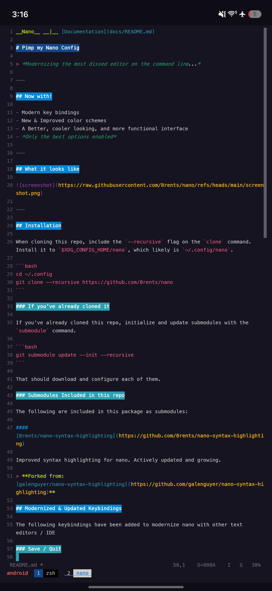

__Nano__ __|__ [Documentation](docs/README.md)

# Pimp my Nano Config

> *Modernizing the most dissed editor on the command line...*

---

## Now with!

- Modern key bindings
- New & Improved color schemes
- A Better, cooler looking, and more functional interface
- *Only the best options enabled*

---

## What it looks like



---

## Installation

When cloning this repo, include the `--recursive` flag on the `clone` command. Install it to `$XDG_CONFIG_HOME/nano`, which likely is `~/.config/nano`.

```bash
cd ~/.config
git clone --recursive https://github.com/8rents/nano
```

### If you've already cloned it

If you've already cloned this repo, initialize and update submodules with the `submodule` command.

```bash
git submodule update --init --recursive
```

That should download and configure each of them.

### Submodules Included in this repo

The following are included in this package as submodules:

#### [8rents/nano-syntax-highlighting](https://github.com/8rents/nano-syntax-highlighting)

Improved syntax highlighting for nano. Actively updated and growing.

> **Forked from: [galenguyer/nano-syntax-highlighting](https://github.com/galenguyer/nano-syntax-highlighting)**

## Modernized & Updated Keybindings

The following keybindings have been added to modernize nano with other text editors / IDE

### Save / Quit

- `ctrl+Q`   Quit
- `ctrl+S`    Save
- `alt+S`     Save As

### Undo / Redo Last Command

- `ctrl+Z`    Undo
- `alt+Z`    Redo

### Copy / Paste

- `ctrl+C`    Copy
- `ctrl+V`    Paste
- `ctrl+X`    Cut
- `ctrl+K`    Zap: Delete line

### Edit Current Line

- `alt+[`     Unindent current line
- `alt+]`     Indent current line
- `ctrl+/`    Comment/uncomment current line


### Find / Replace

- `ctrl+F`    Search forwards (= alt+W with prompt)
- `alt+F`    Search backwards (= alt+E with prompt)
- `ctrl+R`   Replace
- `ctrl+G`    Find Next
- `alt+G`     Find Previous

### Macros

- `alt+:`     Record macro
- `alt+;`   Play macro

### Buffer Navigation

- `alt+,`     switch to previous file
- `alt+.`   switch to next file
- `ctrl+T`    Run terminal command and place output in new buffer

### Edit Document

- `ctrl+E`    Spell Check
- `alt+F`  Format Document
- `alt+L`     Lint Document

### Navigation

- `ctrl+L`    goto line number
- `ctrl+Up`   goto previous block
- `ctrl+Dwn`  goto next block
- `ctrl+}`    goto matching bracket
- `alt+Up`    goto head of file (vialt+like)
- `alt+Dwn`   goto end of file


---

## Repository Development

Where this repository is going and where it's been

- [List of Past Changes by Version (Changelog)](../CHANGELOG.md)
- [List of Upcoming Changes (To Do List)](../TODO.md)

---

## Documentation, Guides & Articles

Articles to help you better understand configuring nano

- [Multibuffer& Workflow Tips](docs/multibuffer-and-tips/README.md)
- [Working with colors in Nano](docs/colors/README.md)
- [Notable Options](docs/notable-options/README.md)
- [Functions in Nano and binding them to create a more modern feel](docs/function-binding/README.md)

---

## Links / Sources

Some of the sources that I've found helpful while putting together this repository

- [Reddit/Ask Linux - What does your nanorc look like?](https://www.reddit.com/r/linux/comments/1f3jeoo/what_does_your_nanorc_look_like)
- [davidhcefx/nanorc - Modern Nano Keybindings](https://github.com/davidhcefx/Modern-Nano-Keybindings)
- [scopatz/nanorc - Improved Nano Syntax Highlighting Files](https://github.com/scopatz/nanorc)

---

__(Ɔ) 2026__ [8rents](https://github.com/8rents) under the [MIT License](LICENSE.md)